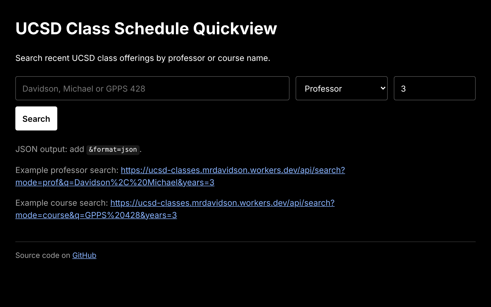
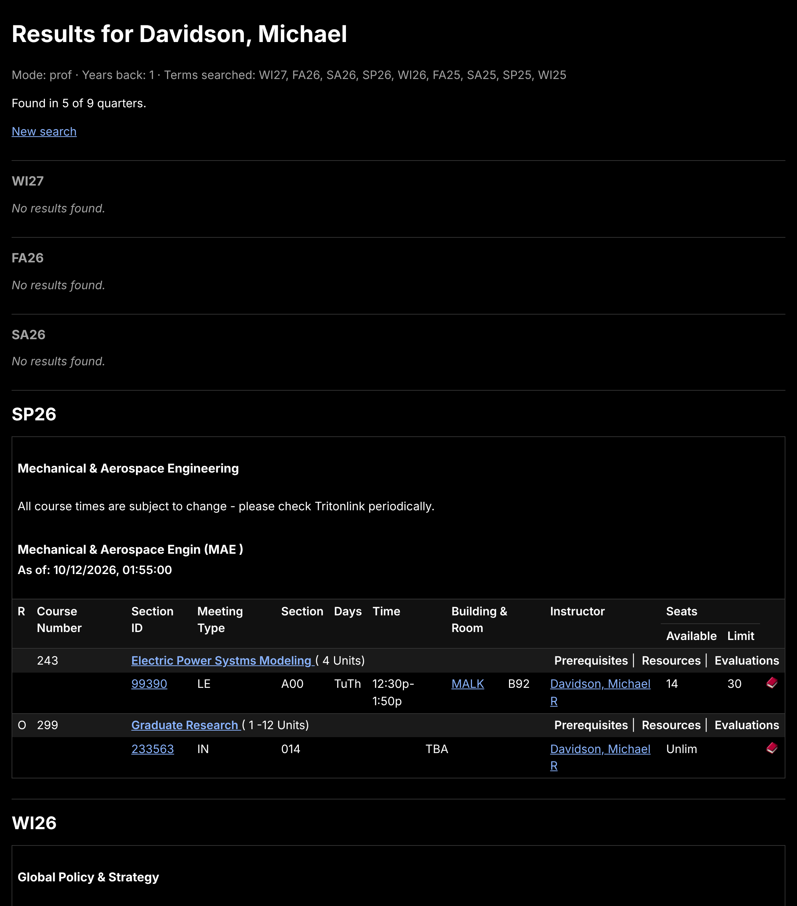

# UCSD Class Schedule Quickview

The [UCSD Schedule of Classes](https://act.ucsd.edu/scheduleOfClasses/scheduleOfClassesStudent.htm) is somewhat difficult to navigate. This repo allows you to quickly view UCSD course offered in current and previous X years by professor or course name.

This repo focuses on historical searching: which quarters a professor taught, or a course was offered, over the past several years. To browse and plan the current or upcoming quarter, [TSS++](https://tssplusplus.vercel.app) ([source](https://github.com/alchin2/tssplusplus)) is a useful visualizer, with course search, prerequisite graphs, a schedule planner and a finals view.

## Cloud Usage

A Cloudflare Workers instance allows for web-based retrieval of results.

Visit: [**https://ucsd-classes.mrdavidson.workers.dev/**](https://ucsd-classes.mrdavidson.workers.dev/)

Example professor search: https://ucsd-classes.mrdavidson.workers.dev/api/search?mode=prof&q=Davidson%2C%20Michael&years=3

Example course search: https://ucsd-classes.mrdavidson.workers.dev/api/search?mode=course&q=GPPS%20428&years=3

### Data sources

UCSD's legacy [Schedule of Classes](https://act.ucsd.edu/scheduleOfClasses/scheduleOfClassesStudent.htm) no longer returns terms from Fall 2026 (FA26) on. The Worker picks a source for each quarter:

- **FA26 and later:** [UCSD Class Planner](https://classplanner.apps.ucsd.edu/search), through its public JSON API. The Worker builds the results table itself, in the same style as the legacy one, with seat and waitlist counts. Each of these quarters shows a "Source: UCSD Class Planner" link.
- **Summer 2026 and earlier:** the legacy Schedule of Classes on act.ucsd.edu, as before (its newest term is SA26).

Class Planner only publishes a term shortly before it starts. As of November 2026 it has FA26 but not WI27, so WI27 shows "Not yet published in UCSD Class Planner." until UCSD adds it. No code change is needed when that happens.

Class Planner API notes (no sign-in needed for these; the non-`public` routes answer 401):

- `POST /api/v1/public/catalog/courses/search` with a JSON body (`term_code`, `course_key: ["CSE 008A"]` or `instructor: ["Michael Davidson"]`, `offset`, `limit` of at most 48). Course numbers are zero-padded.
- `GET /api/v1/public/catalog/filters?term_code=FA26` lists every instructor name for the term. A professor search matches the typed name against this list (full last name plus first initial, so "Davidson, Michael" also finds "Mike Davidson"), then searches with the exact names. The text search (`q`) doesn't cover instructor names.
- The public API has no room numbers, so the Room column is hidden for these quarters.
- An unpublished term answers 404 with `"This term is not available in the public Schedule of Classes."`

### What you see

The site uses a white-on-black design.

- **Search page:** a single form. Enter a professor (`Last, First`) or a course (`GPPS 428`), choose Professor or Course, and set how many years back to search. Example links and a link to this repository are underneath.
- **Results page:** one section per quarter, newest first, with a "Found in N of M quarters" summary at the top.
  - A quarter with classes shows only UCSD's results table: course, section, meeting type, days, time, room, instructor and seats. UCSD's "Your search was" box, navigation bars and site footer are removed.
  - A quarter with no classes shows only "No results found." in gray, so it's easy to skip past.
  - Links in the table (section IDs, buildings, prerequisites, evaluations, instructor email) open on UCSD's site.





### Endpoints

- `/` — search page
- `/api/search?mode=prof&q=Davidson,%20Michael&years=3`
- `/api/search?mode=course&q=GPPS%20428&years=3`
- Add `&format=json` for JSON output. Each quarter includes `found: true/false` and the cleaned HTML.
- `/healthz` — simple health endpoint


## Local Usage

Relevant files:
- `quickview_prof.sh`
- `quickview_coursename.sh`
- `extract_results.sh` (shared helper: keeps only each quarter's results table, or prints "No results found.")

These scripts only query the legacy act.ucsd.edu site, so they return nothing for FA26 and later. Use the website for upcoming quarters.

The scripts write `quickview_prof.html` or `quickview_coursename.html` in the same white-on-black style as the website, then open it in your browser.

Example usage (only tested for `bash` terminal):

```
./quickview_coursename.sh "GPPS 428"

./quickview_prof.sh "Davidson, Michael"

# Get last four years plus current year of results:
./quickview_prof.sh "Davidson, Michael" 4  
```

## Dev

### Local Development

```bash
npm install
npm run dev
```

### Tests

```bash
npm test
```

Tests run the result extractor (`src/extract.js`) against saved UCSD pages in `test/fixtures/`. If UCSD changes its page layout, save a fresh response there and update the extractor.

The Class Planner client (`src/classplanner.js`) and table renderer (`src/render-classplanner.js`) are tested against `test/fixtures/classplanner-search.json` and `test/fixtures/classplanner-filters.json`, real FA26 responses captured on 2026-11-06 and trimmed. If Class Planner changes its format, save fresh responses there.

### Deploy

Pushes to `main` deploy automatically through [Cloudflare Workers Builds](https://developers.cloudflare.com/workers/ci-cd/builds/). One-time setup in the Cloudflare dashboard:

1. Workers & Pages → `ucsd-classes` → Settings → Builds → **Connect**, and pick this GitHub repository.
2. Build settings:
   - Production branch: `main`
   - Build command: `npm test`
   - Deploy command: `npx wrangler deploy`
   - Root directory: `/`
3. The Worker name in the dashboard must match `name` in `wrangler.jsonc` (`ucsd-classes`).

Builds for non-production branches are currently turned off, so pull requests don't get a Cloudflare check. To turn them back on, set the non-production branch deploy command to `npx wrangler versions upload`. Don't use `npx wrangler preview`: that command doesn't exist in Wrangler 4 and fails the build.

Manual fallback:

```bash
npm install
npm run deploy
```

## Notes

This app still depends on UCSD's upstream schedule page structure and form fields, and on the Class Planner API's request and response format. If UCSD changes either, the Worker may need updates.
